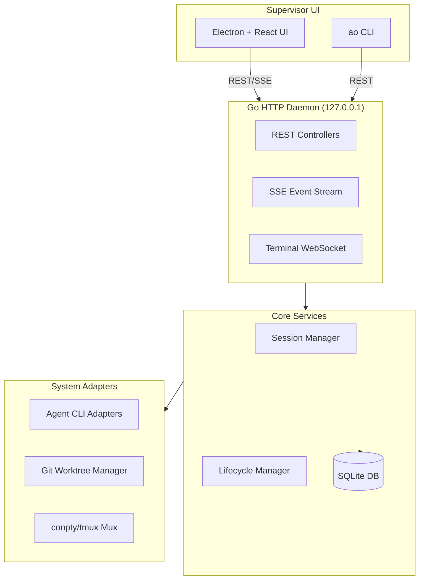

# GIT_WIZ — Project Specification Sheet

## 1. Executive Summary
**GIT_WIZ** is a next-generation local agentic IDE and harness designed to orchestrate, supervise, and coordinate multiple AI coding agents working in parallel. It provides a managed control layer for terminal-based coding agents (such as `claude-code`, `aider`, `codex`, `cline`, and `opencode`), housing them in isolated git worktrees, tracking their lifecycle state, and routing automated feedback loops directly into their terminals.

By shifting parallel agent coordination from a manual chore to a structured, observable workflow, GIT_WIZ allows software engineers to act as supervisors to a fleet of parallel AI agents.

---

## 2. The Real-World Problem It Solves
When developers start running multiple AI coding agents in parallel to speed up feature development, they quickly run into several operational bottlenecks:

1. **Context & Workspace Collision**: 
   Running multiple agents on the same local repository leads to overlapping file modifications, broken dependency states, and dirty Git working directories.
2. **Terminal Sprawl & Babysitting**: 
   Coordinating four or five agents requires maintaining multiple open terminal tabs, manually watching logs, and tracking the individual status of each task.
3. **Broken Feedback Loops**:
   If a pull request pushed by an agent fails a CI check, receives review comments, or runs into merge conflicts, the developer has to manually copy-paste the error logs back to the agent's terminal context so it can fix its work.
4. **Lack of Central Coordination**:
   There is no coordination layer to delegate large tasks to multiple workers, keep them updated, or aggregate their results back into a main branch.

---

## 3. How GIT_WIZ Solves the Problem
GIT_WIZ resolves these pain points through a local, three-tiered architecture (Go daemon + Electron supervisor UI + isolated workspaces):

### Isolated Workspaces (Git Worktrees)
For every agent session spawned, GIT_WIZ creates an isolated **Git Worktree** in a separate directory on disk, bound to a dedicated branch.
* Agents never step on each other's files.
* Dependencies can be built and tested independently.
* Main codebase remains completely clean.

### Live Terminal & Status Tracking
The local Go daemon serves as a central registry that monitors session state, terminal processes, and Git commands:
* **Durable Facts**: The daemon persists raw, objective session facts (such as last reported terminal states like `active`, `idle`, `waiting_input`, `blocked`, and `exited`).
* **Derived Read Model**: Rather than storing derived states, GIT_WIZ computes the user-facing display status (e.g., `working`, `needs_input`, `ci_failed`, `mergeable`) on-the-fly at read time.
* **Xterm Interactive Terminals**: The Electron frontend provides an interactive terminal pane where the developer can attach to any agent session in real time.

### Automated Feedback Routing (Hooks)
GIT_WIZ uses hidden hook triggers (`ao hooks <agent> <event>`) to establish feedback loops:
* **CI Failures**: The daemon monitors GitHub actions/CI status. If a PR's checks fail, it feeds the raw terminal test failures back into the agent's terminal stream.
* **Review Comments**: Review feedback left on GitHub PRs is routed back to the agent's context, letting the agent reply to comments or implement requested changes automatically.
* **Input Gates**: Actions requiring human permission (e.g. executing external scripts or calling APIs) trigger a `blocked` state in the daemon. This blocks automation from sending inputs until the user grants explicit approval in the UI.

---

## 4. Key Features & Capabilities
* **Parallel Worker Fleets**: Spawn multiple workers concurrently on different tasks or branches.
* **Orchestrator-Worker Coordination**: Spawn a central `Orchestrator` session to delegate sub-tasks to multiple focused `Worker` sessions, coordinating cross-session merges.
* **Interactive Git Review Rail**: Inspect changes file-by-file, stage/discard modifications, write commit messages, and create pull requests directly from the UI.
* **In-App Browser Preview**: Preview the running local web app (using an embedded web preview) side-by-side with the agent's terminal.
* **Mobile Connectivity ("Connect Mobile")**: Enable an optional, password-authenticated LAN listener to view the session board and triage tasks from a physical mobile device on the home network.

---

## 5. Technical Architecture
GIT_WIZ is built for low-latency, reliability, and local data ownership:

* **Go Backend Daemon**: Leverages Cobra CLI, Chi Router, and modernc Go-SQLite.
* **Electron + React Frontend**: Clones the original visual aesthetic verbatim—utilitarian, near-black slate layout with a single-accent refined blue control theme.
* **Change Data Capture (CDC)**: SQLite triggers record database row changes into a `change_log` table. A CDC poller tails this log and pushes real-time server-sent events (SSE) to update the React board.
* **Port-Based Design**: Decouples domain logic from concrete agent tools, enabling modular adapters for new agent CLIs (`aider`, `claude-code`, etc.).

---

## 6. Project Goals
1. **Developer Leverage**: Multiply developer output by transforming the developer from a line-writer into an engineering supervisor.
2. **Local Ownership**: Keep code, database records, and logs residing entirely on the local system (`~/.ao` or `~/.git-wiz`) without mandatory external cloud sync.
3. **Harness Agnosticism**: Support any agent tool that runs in a terminal by writing clean, declarative adapters.
